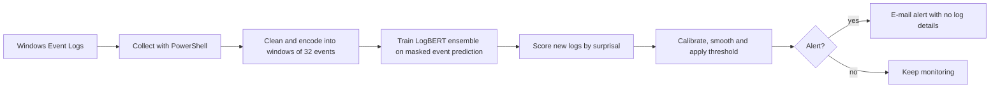

# LogBERT Local Guard

A personal, on-device anomaly detector for Windows. It learns what "normal" looks like in your laptop's Windows Event Logs using a small BERT-style transformer, then alerts you by e-mail when new activity does not fit your usual pattern.

> **No attack data needed.** The model only ever sees your own normal logs. Anything that does not fit that pattern is treated as suspicious.

---

## Highlights

- **Unsupervised anomaly detection**: trained on normal behaviour only, with no labelled attacks required.
- **Runs locally**: logs and models stay on your machine. The alert e-mail contains no log details by design.
- **Collects its own data**: pulls the last 15 days of the Windows `System` and `Application` logs through PowerShell.
- **Small transformer ensemble**: 3 compact LogBERT models (2 layers, 64-dim embeddings) whose scores are averaged.
- **Controlled false alarms**: the alert threshold is set from validation data and capped at about 0.5 alerts per day.
- **Adapts over time**: if behaviour changes for several days in a row, it relearns a new profile automatically.
- **Honestly evaluated**: tested by injecting synthetic anomalies and compared against two simple baselines.

---

## How it works



### 1. Events become words
Every log event has a *Provider* (which component wrote it) and an *Event ID* (what happened). They are joined into one key such as `Provider:EventID`. Each key is treated like a **word**, and a run of 32 consecutive events (a **window**) is treated like a **sentence**. Windows slide forward 8 events at a time, so they overlap.

### 2. Learning by fill-in-the-blank
The model is trained like BERT: about 15% of the events in each window are hidden and the model must guess them from the events around them. After many rounds on your normal logs it becomes good at predicting "what event usually belongs here?". The provider, level and log name of hidden events are hidden too, so the model cannot cheat.

### 3. Scoring by surprisal
For new logs, every event is hidden in turn (7 masking rounds so each event is hidden exactly once) and the model is asked how likely the real event was. **Surprisal** is the negative log of that probability. Low surprisal means the event fits. High surprisal means the event is unexpected.

Two scores are combined:

| Score | What it catches |
|---|---|
| `surprisal_mean` | Overall unusual order or mix of events in a window |
| `surprisal_topk` | A few very unexpected events (the 4 worst) inside an otherwise normal window |

Event types never seen during training receive a fixed high penalty.

### 4. From score to alert
1. **Calibration**: scores are rescaled with the median and MAD of validation data (a robust z-score).
2. **Smoothing**: each score is averaged with the previous 2 windows so one blip does not fire an alert.
3. **Threshold**: the 99th percentile of validation scores, raised if needed so validation data would produce at most 0.5 alert episodes per day.
4. **Episodes**: flagged windows that are close together are merged into one alert.

---

## Requirements

- **Windows 10/11** with PowerShell (required for automatic log collection; the rest of the notebook runs on any OS if you provide CSV files)
- Python 3.9 or newer
- `torch` (PyTorch 2.x recommended), `numpy`, `pandas` 2.0 or newer (needed for ISO 8601 timestamp parsing), `matplotlib`, `scikit-learn`, `jupyter`
- A GPU is optional. The models are small and train on CPU.

```bash
pip install torch numpy pandas matplotlib scikit-learn jupyter
```

---

## Quick start

1. Clone the repository and open a terminal in its folder.
2. Install the requirements (above).
3. Start Jupyter. **On the first run, start it as administrator** so Windows allows the logs to be read.
   ```bash
   jupyter notebook
   ```
4. Open `LogBERT_Local_Guard_01.ipynb` and run the cells from top to bottom.
   - **Step 3** collects the last 15 days of logs into `data/<your-username>/`.
   - **Step 10** trains your personal model.
   - **Step 11** evaluates it.
   - **Step 19** runs the guard.

### Using your own CSV logs instead
Place CSV files in `data/<any-name>/`. Each file needs these columns:

| Column | Required | Example |
|---|---|---|
| `TimeCreated` | Yes | `2026-11-22T14:05:12+05:30` (ISO 8601) |
| `EventID` | Yes | `7036` |
| `Provider` | Yes | `Service Control Manager` |
| `Level` | No | `Information`, `Warning`, `Error` |
| `LogName` | No | `System` |

At least **5 days** of logs are needed, and the validation period needs at least 20 windows.

---

## Code map

| Step | Key code | What it does |
|---|---|---|
| 1 | `torch.cuda.is_available()` | Checks Python, PyTorch and GPU |
| 2 | Settings block | Holds every tunable setting in one place |
| 3 | `collect_logs`, `read_windows_log` | Exports the last 15 days of System and Application logs to CSV with PowerShell `Get-WinEvent` |
| 4 | `load_logs`, `check_coverage`, `list_users` | Reads CSVs, validates columns and timestamps, reports days covered |
| 5 | `add_keys`, `collapse_repeats`, `preprocess`, `split_days`, `build_vocabs`, `encode`, `make_windows`, `prepare_user` | Builds event keys, merges repeats, splits by day (train, validation, test), builds the vocabulary from training days only, cuts windows |
| 6 | `explore_user` | Statistics and plots (events per day and per hour) |
| 7 | `LogBERT`, `apply_mask`, `random_mask`, `vhm_loss` | The transformer model and the masking logic |
| 8 | `score_components`, `fit_calibration`, `standardize`, `combine_z`, `smooth`, `find_episodes`, `choose_threshold`, `Detector`, `load_trained` | Surprisal scoring, calibration, smoothing, episodes and threshold selection |
| 9 | `run_epoch`, `train_member`, `train_user` | Trains the ensemble with early stopping and saves model, vocabulary and settings |
| 10 | `train_user(FIRST_USER)` | Trains the first user |
| 11 | `FrequencyBaseline`, `BigramBaseline`, `inject_stream`, `evaluate_user`, `plot_test_scores` | Injected-anomaly evaluation with AUC and baseline comparison |
| 12 | Loop over `USERS` | Trains and evaluates all users and writes summary CSVs |
| 13 | `make_rolling_splits`, `rolling_evaluation` | Optional. Repeated time-ordered folds for a more trustworthy false-alarm estimate |
| 14 | Cross-user AUC loop | Scores one user's logs with another user's model and plots a heatmap |
| 15 | `send_alert` | SMTP e-mail alert, or a dry run if not configured |
| 16 | `describe_episode`, `detect_new_logs` | Scores new logs and writes the plain-English reason for each alert |
| 17 | `recalibrate` | Refreshes the threshold from recent normal logs |
| 18 | `detect_profile_shift`, `archive_profile`, `learn_profile`, `reset_profile`, `monitor` | Detects a lasting behaviour change and rebuilds the profile |
| 19 | `run_guard`, `watch` | Main entry point. Trains if needed, otherwise monitors, and repeats every 6 hours |

---

## Configuration

All settings are in **Step 2**.

| Setting | Default | Meaning |
|---|---|---|
| `FAST_CHECK` | `False` | Quick test mode: 1 model, 25 epochs, fewer injections |
| `LOG_DAYS` | `15` | Days of history to collect |
| `WINDOW_SIZE` / `STRIDE` | `32` / `8` | Events per window and how far the window slides |
| `VAL_DAY_FRACTION` / `TEST_DAY_FRACTION` | `0.15` / `0.15` | Share of days kept for validation and testing |
| `EMBED_DIM`, `NUM_LAYERS`, `NUM_HEADS`, `FF_DIM` | `64`, `2`, `2`, `128` | Transformer size |
| `MASK_RATIO` | `0.15` | Share of events hidden during training |
| `N_ENSEMBLE` | `3` | Number of models averaged |
| `MAX_EPOCHS` / `PATIENCE` | `400` / `15` | Training limit and early-stopping patience |
| `MASK_ROUNDS` | `7` | Masking rounds used when scoring |
| `TOPK_EVENTS` | `4` | Worst events averaged in `surprisal_topk` |
| `SURPRISAL_CAP` | `8.0` | Maximum surprisal per event |
| `SMOOTH_WINDOWS` | `3` | Windows averaged when smoothing |
| `THRESHOLD_PERCENTILE` | `99` | Percentile of validation scores used for the threshold |
| `ALERTS_PER_DAY_BUDGET` | `0.5` | Maximum alert episodes per day on validation data |
| `CHANGE_STREAK_DAYS` / `SHIFT_FLAG_SHARE` | `3` / `0.25` | Behaviour counts as changed if at least 25% of windows are flagged for 3 days in a row |
| `RESET_LEARN_DAYS` / `OBSERVATION_DAYS` | `7` / `5` | Days to learn a new profile, then days of quiet period |
| `WATCH_MINUTES` | `360` | How often `watch()` checks |
| `USE_VHM` | `False` | Optional hypersphere loss from the original LogBERT paper |
| `USE_CONTEXT_FEATURES` | `False` | Optional hour-of-day, time-gap and repeat-count features |
| `AUTO_COLLECT` / `AUTO_RESET` | `True` / `True` | Collect logs automatically and relearn automatically after a behaviour change |

---

## Evaluation

There is no labelled attack data for a personal laptop, so the notebook tests the detector by **injecting synthetic anomalies** into the clean test days:

| Injection | What it simulates |
|---|---|
| `reorder` | Events shuffled out of their usual order |
| `rare_burst` | A burst of rarely seen (but known) events |
| `novel_burst` | A burst of event types never seen in training |
| `time_shift` | Activity at an unusual hour (only when `USE_CONTEXT_FEATURES = True`) |

Each run injects 6 segments of 10 events, repeated 5 times. Windows with at least 25% injected events are compared against clean test windows using **AUC** (1.0 is perfect, 0.5 is a coin flip). Results are compared against two baselines:

- **Frequency baseline**: scores a window by how rare its events are overall.
- **Bigram baseline**: scores a window by how unlikely each event is given the previous one.

The notebook also reports the false-alarm rate on clean test days, the share of injected segments found, a cross-user comparison, and an optional rolling-origin evaluation.

### Results

<!-- Fill in with the numbers from your own run (Step 11, Step 12 and Step 14). -->

| Metric | Value |
|---|---|
| AUC, reorder | — |
| AUC, rare_burst | — |
| AUC, novel_burst | — |
| False-alarm windows on clean test days | — |
| Alert episodes per test day | — |

---

## E-mail alerts

E-mail is off by default (`CONFIGURE_EMAIL = False`), and the guard prints a dry run instead.

1. In **Step 15**, set `CONFIGURE_EMAIL = True`.
2. Run the cell and enter the sender address, an **app password** (typing is hidden) and the recipient.
   For Gmail, create an app password in your Google account security settings.
3. Credentials are held only in environment variables for that session. **Never hard-code or commit credentials.**

An alert looks like this:

> LogBERT Local Guard noticed activity on this laptop that differs from its usual pattern. ... If this was you (for example you installed software), you can ignore this message. If you do not recognise the activity, please check your laptop and change your passwords.

---

## Keeping enough Windows log history

By default Windows keeps small event logs and overwrites old events, so you may get fewer than 15 days. To keep more history, run once in an **administrator** command prompt:

```bat
wevtutil sl System /ms:104857600
wevtutil sl Application /ms:104857600
```

---

## Output files

Everything the notebook writes goes to `outputs/`:

```
outputs/
├── models/<user>/        model.pt, vocab.json, meta.json, training_curve.png
├── figures/              exploration plots, score plots, cross-user heatmap
├── results/              summary_all_users_v2.csv, ablation_all_users_v2.csv, cross_user_auc_v2.csv
├── state/<user>.json     progress while relearning after a behaviour change
├── live/<user>/          most recent logs collected for monitoring
├── archive/              old profiles kept after an automatic reset
└── demo_new_logs/        CSVs used by the Step 16 demo
```

---

## Limitations

- The injected anomalies are **synthetic**. Strong scores show the detector catches that kind of irregularity, not that it catches real malware.
- Only **metadata** is used (provider, event ID, level, log name). The text of log messages is not analysed.
- Automatic log collection is **Windows-only**, and a short history (about 15 days) limits what can be learned.
- The automatic profile reset is a trade-off: an intruder who stays active for several days in a row could be absorbed into the new "normal". Setting `AUTO_RESET = False` keeps the old profile.
- A new profile is quiet for a few days after relearning, so detection is paused during that time.

---

## Privacy and security notes

- Event logs can reveal usernames, software and usage times. **Do not commit `data/` or `outputs/` to a public repository.** Add this to a `.gitignore`:
  ```
  data/
  outputs/
  ```
- Check saved notebook outputs before publishing. Printed paths and tables can contain your username or machine details.
- Use an app password for e-mail, not your main account password.

---

## Reference

This project adapts the ideas in *LogBERT: Log Anomaly Detection via BERT* (Guo, Yuan and Wu, 2021), including masked log key prediction and the optional hypersphere objective, to personal Windows Event Logs.

## Author

`<Your Name>` · `<your email or GitHub profile>`

## License

Add a `LICENSE` file (for example MIT) before publishing.
